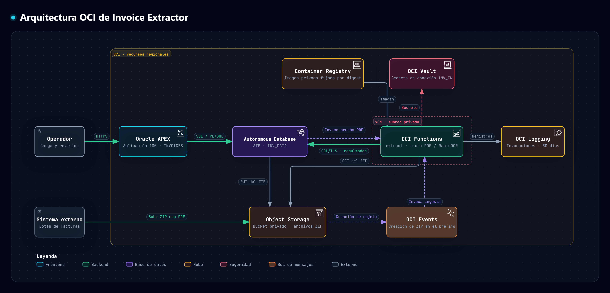

# Diagramas de Invoice Extractor

- [Arquitectura OCI](oci.html) muestra los servicios regionales y los flujos de lotes ZIP y de PDF individual.
- [Modelo de datos](../modelo/inv-data.html) documenta las tablas físicas de `INV_DATA` y enlaza con el DDL.

Los JSON editables fijan la revisión del código que respalda los diagramas. La arquitectura describe los recursos y flujos del despliegue definidos en Terraform y el instalador.



## Del despliegue a la primera factura

| Etapa | Qué hace |
| --- | --- |
| Preparación | El worker de Deploy Studio valida las entradas y publica en OCIR la imagen asociada a la release. |
| Infraestructura | OCI Resource Manager construye el plan y aprovisiona la red de Functions, la Function y las políticas IAM. Bucket, Autonomous Database y Vault se crean o se reutilizan según el formulario. |
| Instalación | El hook instala los esquemas y la aplicación APEX. Invoca la Function con una consulta de solo lectura y habilita la regla de Events si la respuesta confirma acceso a la base. |
| Ingesta | Object Storage conserva los ZIP. OCI Events entrega las cargas nuevas a la Function, que extrae los campos y los escribe mediante `INV_FN`. Logging registra el estado de las invocaciones. |
| Revisión | APEX presenta las evidencias y permite que el operador confirme o corrija el resultado de un lote. `INV_DATA` conserva el valor extraído y el historial de revisión. |

El bucket, Vault o la base reutilizados siguen bajo control de su propietario. Los datos de acceso del instalador y de la Function se gestionan por separado del usuario final de APEX. [Terraform](../../terraform) · [Instalador](../../deploy/hooks/post_apply.py) · [Modelo](../modelo/inv-data.html)

## Regenerar

Desde la raíz del repositorio, asignar a `$archify` la carpeta de la skill Archify 3.2.0 y ejecutar:

```powershell
uv run --locked python docs/arquitectura/render_architecture.py $archify --out-dir build/archify/arquitectura-revision
node "$archify/bin/archify.mjs" finalize erd docs/modelo/inv-data.erd.json docs/modelo/inv-data.html --repo-root . --quality standard --out-dir build/archify/modelo-revision --json
```

Usar una carpeta de evidencia nueva cuando cambie un diagrama. El generador de arquitectura prepara una copia temporal de Archify y carga solo los contornos SVG de `assets/`. Los iconos son blancos en el tema oscuro y usan tinta oscura en el tema claro para conservar el contraste. Los derechos de los iconos pertenecen a Oracle. [Toolkit de Oracle](https://docs.oracle.com/en-us/iaas/Content/General/Reference/graphicsfordiagrams.htm) · [Aviso de los recursos](assets/licenses/oci-NOTICE.txt)
